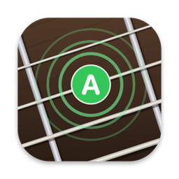
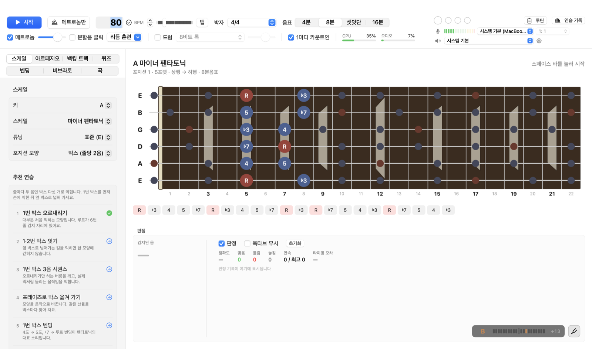
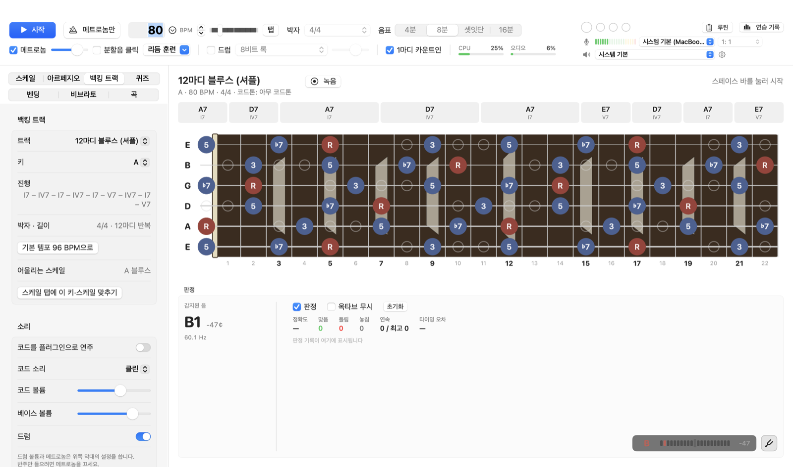
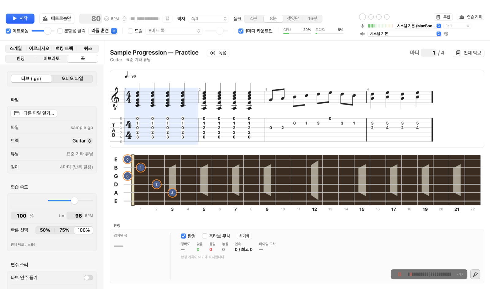
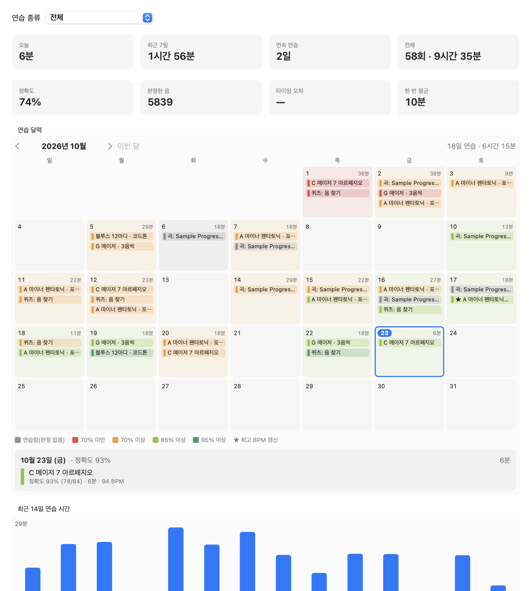
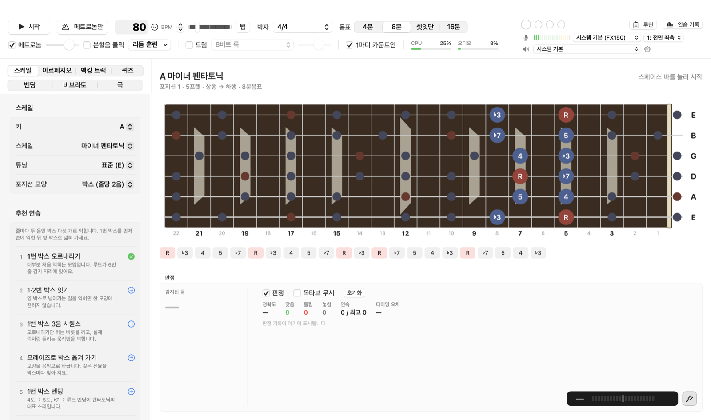

<h1 align="center">Ringout (링아웃)</h1>

<b>듣고 판정하는 기타 연습 앱</b> 
스케일·박자·백킹 트랙·곡 연습에서 내가 친 음을 바로바로 판정합니다. 
macOS · Windows(미리 보기) · 한국어 / English · 왼손잡이 보기 · 무료

  <a href="https://github.com/kita-ikuyo-star/Ringout-Guitar-Practice/releases/latest/download/Ringout-1.1.1.dmg"><b>Mac용 내려받기 (.dmg)</b></a> ·
  <a href="https://github.com/kita-ikuyo-star/Ringout-Guitar-Practice/releases/latest/download/Ringout-1.1.1-windows-x64.zip"><b>Windows용 내려받기 (.zip, 미리 보기)</b></a> ·
  <a href="https://github.com/kita-ikuyo-star/Ringout-Guitar-Practice/releases">모든 릴리스</a>

<a href="README.md">English</a> · <b>한국어</b>

Ringout은 메트로놈·드럼·백킹 트랙에 맞춰 지판에 **지금 칠 음**을 밝게 보여 주고,
기타 소리를 듣고 맞게 쳤는지(맞음·틀림·놓침)와 얼마나 빠르거나 늦었는지를 알려 줍니다.

## 기능

### 선생님과 하듯 스케일 연습
- 마이너·메이저 펜타토닉(5박스 또는 줄당 3음), 블루스, 내추럴 마이너·메이저, 모드(도리안~로크리안), 하모닉·멜로딕 마이너, 크로매틱. 12키, 표준·반음 다운·드롭 D 튜닝.
- 한 포지션, 포지션 잇기, 한 줄, 두 줄로 지판 전체.
- 패턴: 상행·하행·상행→하행, 3음·4음 시퀀스, 3도 도약, 랜덤 순서, 이 앱을 위해 새로 만든 연습 프레이즈.
- N바퀴마다 다음 포지션이나 다른 키로 자동 이동, 스케일마다 익히는 순서대로 **추천 연습**.

### 듣고 판정
- 실시간 음높이 인식으로 박마다 맞음 / 틀림 / 놓침, 정확도·연속 기록·타이밍 오차.
- 지연 보정, 옥타브 무시 옵션, 스트로보·바늘 튜너(A4 = 430–450Hz).
- **벤딩 연습**(¼~1½음, 센트 단위로 측정), **비브라토 연습**(템포에 맞춘 흔들기 간격, 목표 폭, 음높이 그래프).
- 아르페지오와 CAGED 모양, 지판 퀴즈(음 찾기, 음 이름 맞히기, 음정, 듣고 찾기).

### 박자
- 30–300 BPM의 샘플 단위로 정확한 메트로놈, 홑·겹박자(2/4–7/4, 3/8–12/8), 분할음, 카운트인, 탭 템포.
- 드럼 패턴(록, 셔플, 하프타임, 펑크, 원 드롭, 슬로 블루스, 왈츠 등).
- 리듬 훈련: 2·4박이나 엇박에만 클릭, 갭 클릭(소리 없는 마디에도 판정은 계속).
- 속도 훈련: N바퀴마다 BPM 올리기, 실력이 늘면 지판의 도움 표시를 하나씩 걷어 내기.

### 백킹 트랙

- 내장 트랙 17개(블루스, 마이너 블루스, 팝, 록, 펑크, 레게, 디스코, 발라드, 왈츠 등). 코드·베이스·드럼은 모두 이 앱에서 직접 만든 것이고, 키·템포를 마음대로 바꾸거나 나만의 트랙을 만들 수 있습니다.
- **코드톤 연습**: 아무 코드톤, 루트, 3·5·7도, 가이드 톤, 돌아가며. 더블스톱과 코드 전체를 치면 어떤 음이 빠졌는지 알려 줍니다.

### 곡

- **Guitar Pro 7·8(.gp)** 타브 열기: 악보와 타브 보기, 반복·코다 펼치기, 음마다 판정, 25–150% 속도, 반복마다 빨라지는 구간 반복, 내장 기타 소리로 연주.
- **오디오 파일**(MP3·M4A·WAV·AIFF·FLAC)로 곡 익히기: 음높이 그대로 속도 조절, 음높이 ±12반음, 끊김 없는 A–B 구간 반복, 표시 달기.
- 기타와 반주를 따로 **녹음**하고 다시 듣기, 믹스 내보내기.

### 연습 기록

- 연습할 때마다 시간·BPM·정확도·자주 틀린 자리를 자동으로 기록합니다.
- 정확도 색으로 칠한 달력, 연습별 최고 템포, "다시 하면 좋을 연습" 추천.
- 미리 만든 **연습 루틴**(25·35·43분) 또는 나만의 루틴.

### 왼손잡이 연주자

- **설정 → 일반 → 왼손잡이 지판**을 켜면 모든 지판을 좌우로 뒤집어, 내 기타 넥을 볼 때처럼 너트가 오른쪽에 옵니다. *(1.1.1 새 기능)*
- 음 이름은 그대로 읽히고, 줄 순서와 타브·악보 표기는 표준 그대로이며, 지판을 눌러 답하기(퀴즈, 비브라토 음 고르기)도 똑같이 됩니다.

### 소리와 장비
- 입력·출력 장치와 입력 채널 선택, 모니터링, 버퍼 최소 32프레임.
- 앰프·캐비닛 음색을 입힌 내장 기타 소리(클린, 오버드라이브, 디스토션, 통기타).
- 기타 입력과 앱 연주 소리에 거는 플러그인: Mac은 **Audio Unit**, Windows는 **VST3**. 판정은 언제나 플러그인을 거치기 전 소리로 하고, 메트로놈은 플러그인을 거치지 않습니다.

## 필요 환경

| | Mac | Windows (미리 보기) |
|---|---|---|
| 시스템 | macOS 14 Sonoma 이상, Apple 실리콘(M1 이상) | Windows 10·11 64비트 |
| 오디오 | 악기(Hi-Z) 입력이 있는 오디오 인터페이스와 헤드폰 권장 | 같음. WASAPI(공유·독점) |
| 파일 | `Ringout-1.1.1.dmg` | `Ringout-1.1.1-windows-x64.zip` |

마이크로도 쓸 수 있지만, 스피커로 튼 메트로놈 소리가 마이크로 들어가면 음높이 인식을 방해하므로 헤드폰을 쓰세요.

## 설치

**Mac**
1. .dmg를 열고 **Ringout**을 **응용 프로그램(Applications)** 폴더로 끌어다 놓습니다.
2. Apple 개발자 서명이 없어서 처음에는 macOS가 막습니다. 한 번 열어 보고 [완료]를 누른 뒤, **시스템 설정 → 개인정보 보호 및 보안**에서 **그래도 열기**를 누르세요.
3. 마이크(오디오 입력) 권한을 물으면 허용하세요. 기타 소리를 듣는 데 씁니다.

**Windows (미리 보기)**
1. 폴더를 아무 곳에나 풀고 `Ringout.exe`를 실행합니다. 따로 설치되는 것은 없습니다.
2. 코드 서명이 없어서 SmartScreen이 "Windows의 PC 보호" 창을 띄울 수 있습니다. **추가 정보 → 실행**을 누르세요.

> Windows 판은 **미리 보기**입니다. Mac 판과 같은 코드로 만들었지만 아직 실제 Windows PC에서 확인하지 않았습니다. 문제가 있으면 [Issues](https://github.com/kita-ikuyo-star/Ringout-Guitar-Practice/issues)에 알려 주세요.

**내려받은 파일 확인**(선택): 릴리스 페이지의 `SHA256SUMS.txt`와 비교하세요.
Mac: `shasum -a 256 Ringout-1.1.1.dmg` · Windows: `certutil -hashfile Ringout-1.1.1-windows-x64.zip SHA256`

## 개인정보

- Ringout은 **인터넷에 연결하지 않습니다**. 계정·사용 통계·광고·업데이트 확인이 없습니다.
- 연습 기록·루틴·설정·녹음은 내 컴퓨터에만 저장됩니다:
  `~/Library/Application Support/GuitarPractice`(Mac), `%APPDATA%\GuitarPractice`(Windows).
- 입력된 소리는 음높이를 알아내는 데만 쓰이고, **녹음** 버튼을 눌렀을 때만 파일로 저장됩니다.

## 이용 조건

- **Ringout은 무료(프리웨어)입니다.** 연습과 레슨에 자유롭게 쓸 수 있고, 있는 그대로 제공하며 보증하지 않습니다. 판매하거나 고친 판을 배포할 수 없습니다. 다른 사람에게는 파일 대신 이 페이지를 알려 주세요. 전체 조건: [LICENSE.txt](LICENSE.txt).
- 앱 안에는 각자의 라이선스를 따르는 구성 요소가 있습니다: VST3 SDK(MIT, Windows만), Bravura 악보 기호 윤곽선(SIL OFL 1.1), alphaTab에서 옮긴 연주 순서 규칙(MPL 2.0). [THIRD-PARTY-NOTICES.md](THIRD-PARTY-NOTICES.md)를 보세요. 라이선스 전문과 MPL이 요구하는 해당 파일의 소스는 내려받는 파일 안에 들어 있습니다.
- 이 저장소는 앱을 배포하기만 하며, 앱의 소스 코드는 공개하지 않습니다.
- VST·ASIO는 Steinberg Media Technologies GmbH, Guitar Pro는 Arobas Music의 상표이며, Ringout은 이 회사들과 관계가 없습니다.

## 의견 보내기

버그나 아이디어는 [Issues](https://github.com/kita-ikuyo-star/Ringout-Guitar-Practice/issues)에 남겨 주세요. 개인정보가 담긴 녹음이나 파일은 올리지 마세요.

© 2026 Ringout
