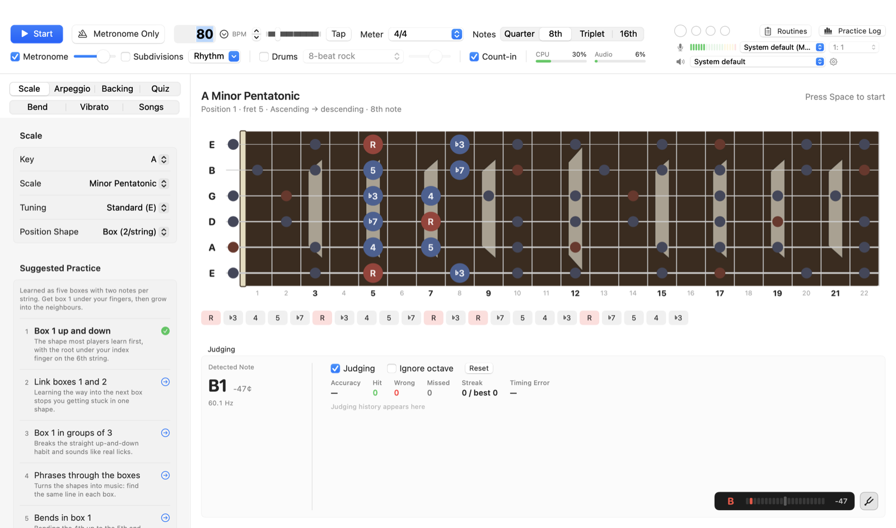
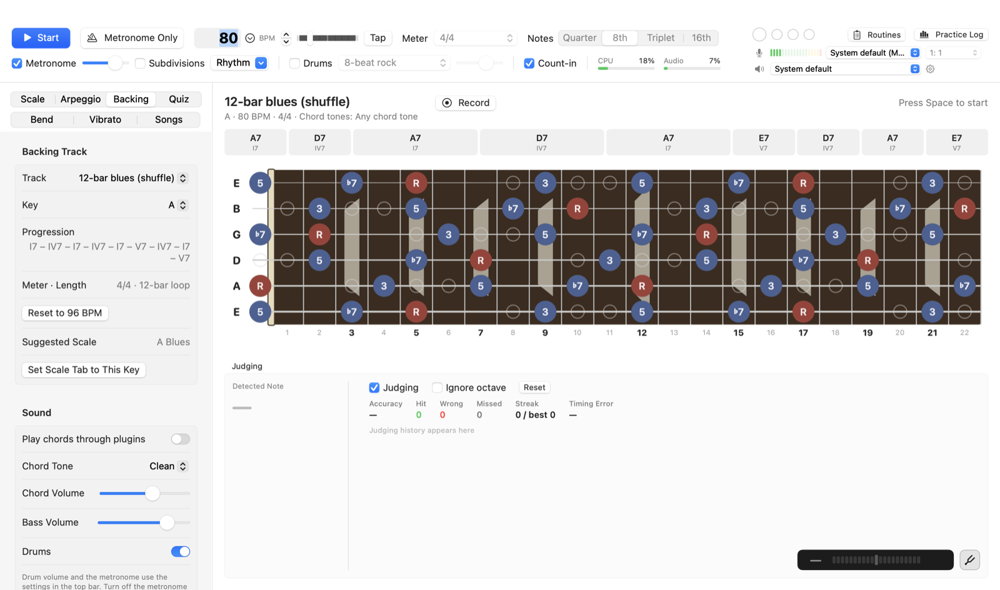
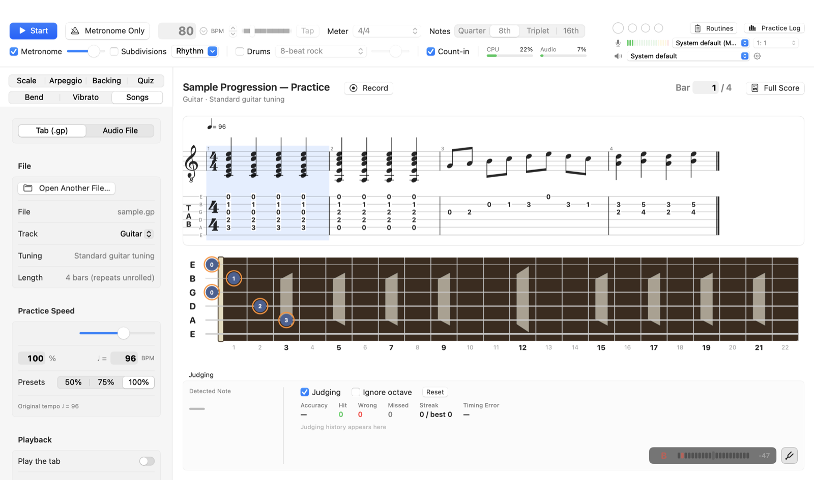
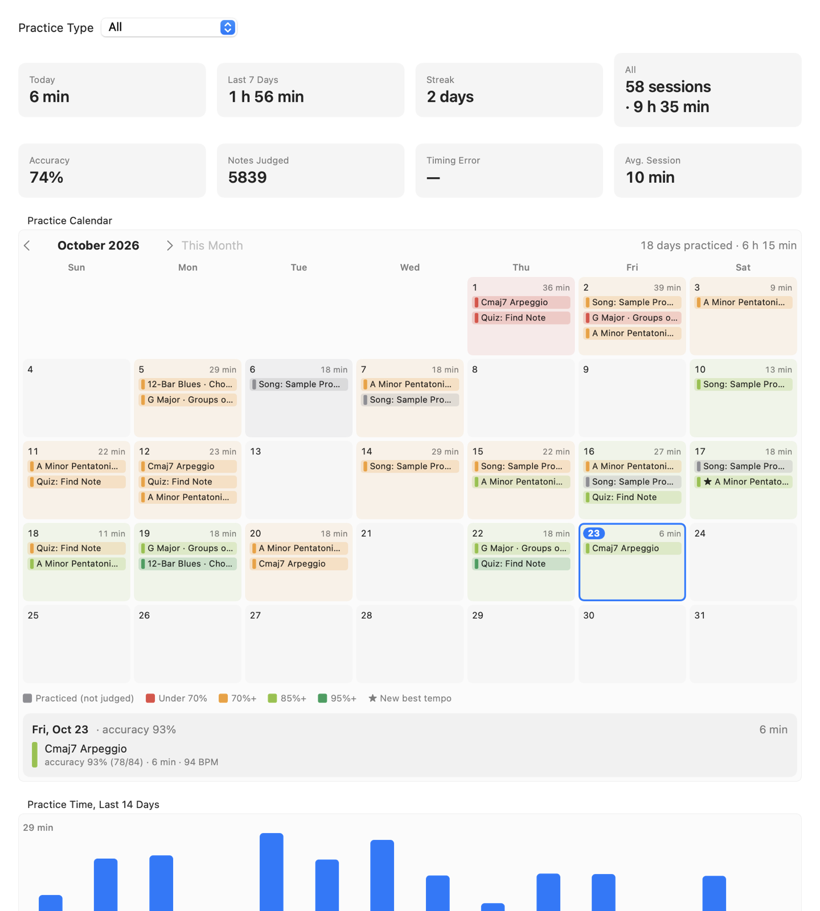
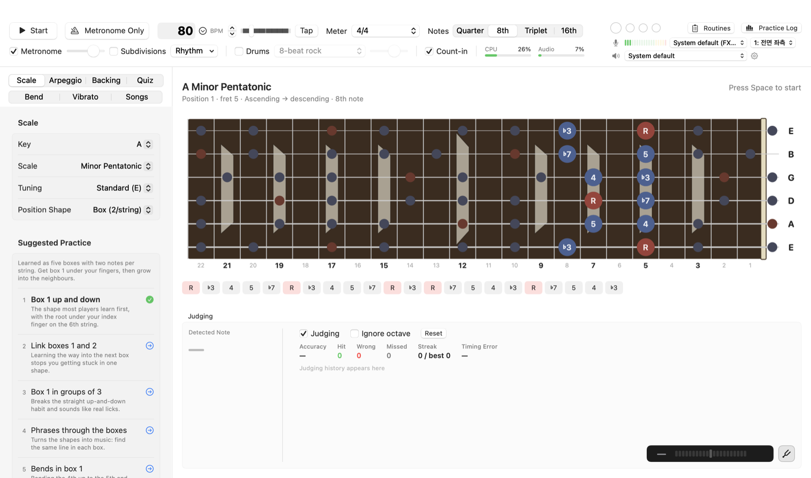

<h1 align="center">Ringout</h1>

<b>Guitar practice that listens.</b> 
Scales, timing, backing tracks and songs, with every note you play judged in real time. 
macOS · Windows (preview) · English / 한국어 · left-handed view · free

  <a href="https://github.com/kita-ikuyo-star/Ringout-Guitar-Practice/releases/latest/download/Ringout-1.1.3.dmg"><b>Download for Mac (.dmg)</b></a> ·
  <a href="https://github.com/kita-ikuyo-star/Ringout-Guitar-Practice/releases/latest/download/Ringout-1.1.3-windows-x64.zip"><b>Download for Windows (.zip, preview)</b></a> ·
  <a href="https://github.com/kita-ikuyo-star/Ringout-Guitar-Practice/releases">All releases</a>

<b>English</b> · <a href="README.ko.md">한국어</a>

Ringout lights up **the note to play now** on the fretboard, in time with a metronome, drums or a backing track,
and listens to your guitar to tell you whether you hit it: right note, wrong note or missed, and how early or late.

## Features

### Practise scales the way you'd practise with a teacher
- Minor/major pentatonic (5 boxes or 3 notes per string), blues, natural minor/major, the modes (Dorian to Locrian), harmonic and melodic minor, chromatic. All 12 keys; standard, half-step-down and drop D tuning.
- Seven-note scales as 3-notes-per-string or **CAGED** shapes (5 positions: each pentatonic box plus the two remaining notes) *(CAGED new in 1.1.3)*.
- One position, linked positions, one string, or two strings across the whole neck.
- Patterns: up, down, up-and-back, groups of 3 and 4, thirds, random order, and practice phrases written for the app.
- Moves to the next position or a new key every N laps; **suggested practice** for each scale in a sensible learning order.

### Hear-and-judge
- Real-time pitch detection judges every beat: hit / wrong / missed, accuracy, streak and timing error.
- **Latency calibration**: play one note on each of 10 clicks and Ringout measures your setup's delay *(new in 1.1.2)*. Also an "ignore octave" option and a strobe/needle tuner (A4 = 430–450 Hz).
- **Bend trainer** (¼ to 1½ tones, measured in cents) and **vibrato trainer** (rate in time with the tempo, target width, pitch graph).
- Arpeggios and CAGED shapes, and fretboard quizzes (find the note, name the note, intervals, ear training).

### Timing
- Sample-accurate metronome from 30 to 300 BPM, simple and compound meters (2/4–7/4, 3/8–12/8), subdivisions, count-in, tap tempo.
- Drum grooves (rock, shuffle, half-time, funk, one drop, slow blues, waltz and more).
- Rhythm training: clicks only on 2 & 4 or off-beats, and gap clicks (bars of silence while judging continues).
- Speed training: +BPM every N laps, and fretboard hints that fade away as you improve.

### Backing tracks

- 17 built-in tracks (blues, minor blues, pop, rock, funk, reggae, disco, ballad, waltz…) with chords, bass and drums written for the app. Change key and tempo freely, or build your own.
- **Chord-tone targets**: any chord tone, root, 3rd, 5th, 7th, guide tones, or rotating. Chords and double stops are checked so the app can tell you which note was missing.
- The progression shows how many bars each chord lasts and highlights the current bar *(new in 1.1.2)*.

### Songs

- Open **Guitar Pro 7/8 (.gp)** tabs: score and tab view, repeats and codas unrolled, every note judged, playback at 25–150 %, loops that speed up each pass, and built-in guitar playback.
- Learn from **audio files** (MP3, M4A, WAV, AIFF, FLAC): change speed without changing pitch, shift pitch ±12 semitones, seamless A–B loops, markers.
- **Record** your guitar and the backing as separate tracks, listen back and export a mix.

### Track your progress

- Every session is logged automatically: time, BPM, accuracy and the spots you miss most.
- A calendar coloured by accuracy, your best tempo for each exercise, and "practise this again" suggestions.
- Ready-made **practice routines** (25, 35 and 43 minutes), or build your own.

### Left-handed players

- Turn on **Settings → General → Left-handed fretboard** to mirror every fretboard so the nut is on the right, the way you see your own neck. *(new in 1.1.1)*
- Note names stay readable, string order and tab/score notation stay standard, and tapping the fretboard (quiz, vibrato note picker) works the same.

### Made for daily practice *(new in 1.1.2)*
- **Picks up where you left off**: tab, key, scale, position, tempo, backing track and song settings are remembered (on Mac, the audio device, input channel and latency too).
- **Getting started guide** on first launch: connect your guitar, check the sound, calibrate, then play your first exercise. Reopen it from **Help** (Mac) or with **F1** (Windows).
- **Keyboard shortcuts**: Space start/stop, ↑/↓ tempo ±1 (Shift ±5), ⌘1–⌘7 / Ctrl+1–7 practice tabs, M metronome only.

### Sound and gear
- Choose input and output devices and the input channel; monitoring; buffer sizes down to 32 frames.
- Built-in guitar sound with amp and cabinet voicing (clean, overdrive, distortion, acoustic).
- Plugin chains for your guitar input and the app's instruments: **Audio Unit** on Mac, **VST3** on Windows. Judging always uses the clean input, and the metronome never goes through the plugins.

## Requirements

| | Mac | Windows (preview) |
|---|---|---|
| System | macOS 14 Sonoma or later, Apple silicon (M1 or later) | Windows 10 or 11, 64-bit |
| Audio | Audio interface with an instrument (Hi-Z) input recommended; headphones recommended | Same. WASAPI (shared or exclusive) |
| Download | `Ringout-1.1.3.dmg` | `Ringout-1.1.3-windows-x64.zip` |

A microphone works too, but a metronome playing through speakers into a microphone confuses the pitch detection, so use headphones.

## Install

**Mac**
1. Open the .dmg and drag **Ringout** into **Applications**.
2. The app isn't signed with an Apple Developer ID, so macOS blocks it the first time. Open it once, click **Done**, then go to **System Settings → Privacy & Security** and click **Open Anyway**.
3. Allow microphone (audio input) access when asked. The app uses it to hear your guitar.

**Windows (preview)**
1. Unzip the folder anywhere and run `Ringout.exe`. Nothing else gets installed.
2. The app isn't code-signed, so SmartScreen may say "Windows protected your PC". Click **More info → Run anyway**.

> The Windows version is a **preview**. It is built from the same code as the Mac app but hasn't been tested on Windows PCs yet. Please report any problems in [Issues](https://github.com/kita-ikuyo-star/Ringout-Guitar-Practice/issues).

**Check your download** (optional): compare with `SHA256SUMS.txt` on the release page.
Mac: `shasum -a 256 Ringout-1.1.3.dmg` · Windows: `certutil -hashfile Ringout-1.1.3-windows-x64.zip SHA256`

## Privacy

- Ringout **never connects to the internet**. There are no accounts, analytics, ads or update checks.
- Your practice history, routines, settings and recordings stay on your computer:
  `~/Library/Application Support/GuitarPractice` (Mac) or `%APPDATA%\GuitarPractice` (Windows).
- Audio input is used only to detect pitch, and is saved to a file only when you press **Record**.

## Licence

- **Ringout is freeware**: free to use for practice and teaching, provided as is with no warranty. You may not sell it or distribute modified copies. Please share this page rather than the files. Full terms: [LICENSE.txt](LICENSE.txt).
- The app includes third-party components under their own licences: the VST3 SDK (MIT, Windows only), the Bravura music font outlines (SIL OFL 1.1) and playback-order rules ported from alphaTab (MPL 2.0). See [THIRD-PARTY-NOTICES.md](THIRD-PARTY-NOTICES.md). The full licence texts, and the MPL-covered source files as that licence requires, are included in each download.
- This repository only distributes the app. The app's own source code isn't published.
- VST and ASIO are trademarks of Steinberg Media Technologies GmbH. Guitar Pro is a trademark of Arobas Music. Ringout isn't affiliated with either company.

## Feedback

Found a bug or have an idea? Open an [issue](https://github.com/kita-ikuyo-star/Ringout-Guitar-Practice/issues). Please don't attach recordings or files that contain personal information.

---

## 한국어

**Ringout(링아웃)** 은 기타 소리를 듣고 맞게 쳤는지 바로 판정하는 무료 기타 연습 앱입니다(Mac, Windows 미리 보기).
기능·설치·개인정보·이용 조건을 한국어로 보려면 **[한국어 안내 페이지](README.ko.md)** 를 보세요.

© 2026 Ringout
